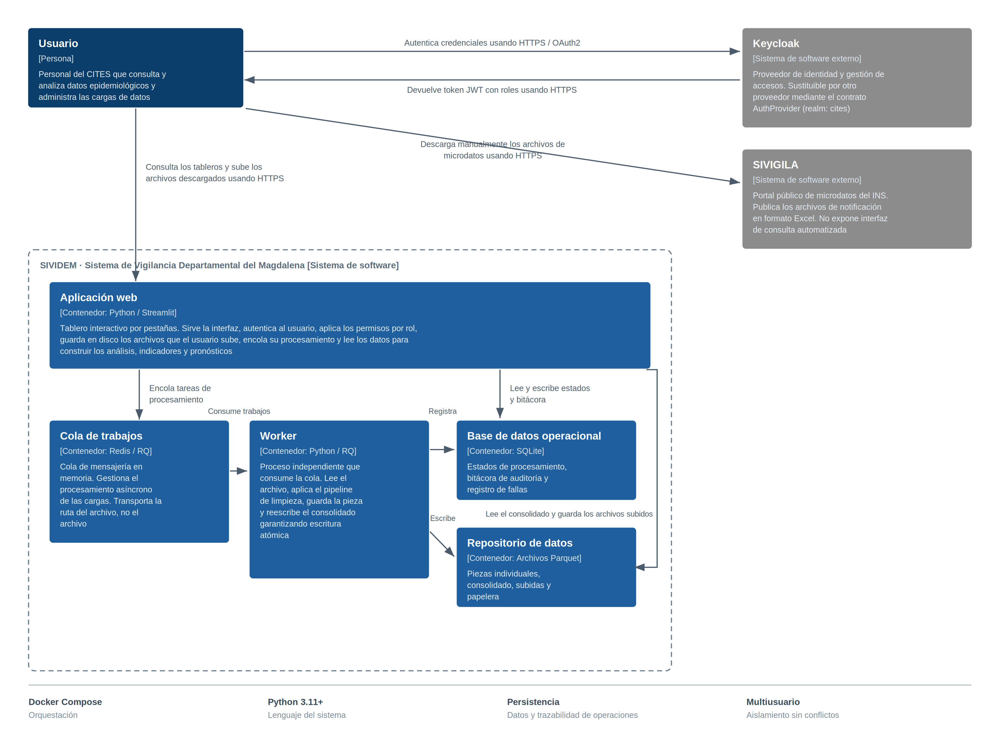
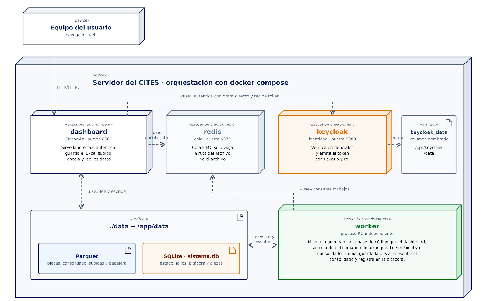
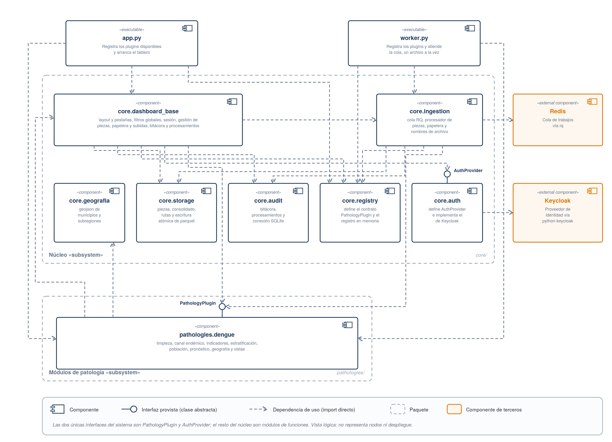
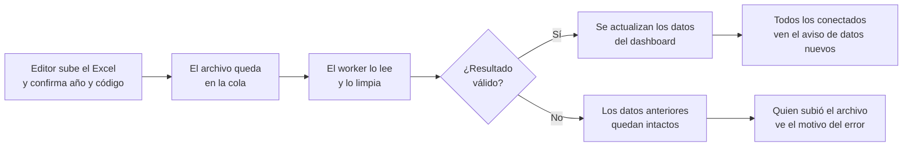
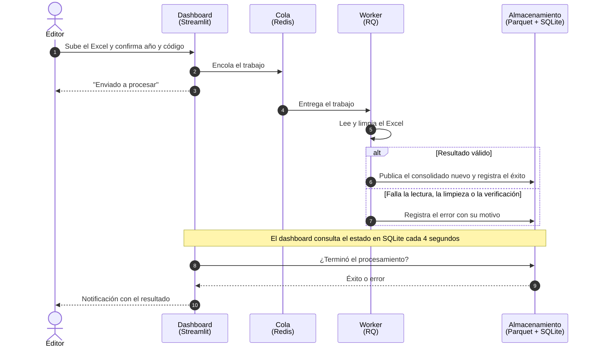
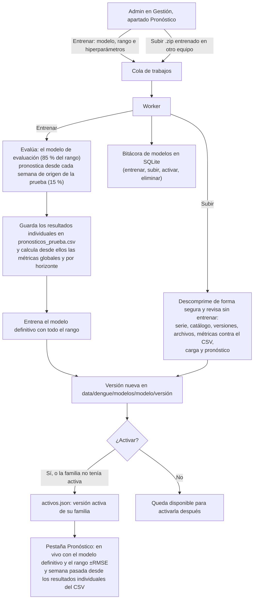

<p align="center">
  
</p>

<p align="center">
  Sistema de Vigilancia Departamental del Magdalena<br>
  CITES - Centro de Innovación y Transferencia en Salud, Universidad del Magdalena
</p>

# SIVIDEM

SIVIDEM es un dashboard web de vigilancia epidemiológica para el departamento del Magdalena (Colombia). Convierte los microdatos que publica el INS en el portal SIVIGILA en indicadores, mapas, canales endémicos y pronósticos de corto plazo, listos para apoyar decisiones de salud pública a nivel departamental, subregional y municipal.

La primera patología implementada es dengue. El sistema está construido como plataforma modular: cada patología es un plugin que cumple un contrato común, de modo que se pueden agregar nuevas (por ejemplo tuberculosis) sin modificar el núcleo.

La investigación que sustenta el sistema (análisis exploratorio, variables climáticas y comparación de modelos de pronóstico) está en el repositorio [dengue-surveillance-magdalena](https://github.com/Edmh1/dengue-surveillance-magdalena). Ver [Investigación y modelado](#investigación-y-modelado).

## Qué ofrece

- Situación actual: incidencia, mortalidad y letalidad del año (con alerta si la letalidad supera la meta nacional del INS), mapa del estado epidemiológico de cada subregión y canal endémico del territorio filtrado, con selector de método (cuartiles por defecto, o Bortman).
- Pronóstico: casos esperados en las próximas 1 a 6 semanas con el mejor modelo de cada familia (estadístico, aprendizaje automático y aprendizaje profundo), sin variables climáticas, con opción de compararlos. Cada semana pronosticada va con un rango orientativo (±RMSE) y, en un bloque aparte, con las métricas que tuvo el modelo en la prueba para ese horizonte. Un modo de semana pasada muestra los pronósticos individuales de la prueba, en semanas que el modelo no había visto, contra lo que ocurrió. La pestaña solo muestra: los modelos se gestionan desde Gestión, solo por el perfil de administración. Ver [Pronóstico: modelos y desempeño](#pronóstico-modelos-y-desempeño).
- Tendencia: casos por año filtrables desde el mapa, comparación semanal contra el año anterior, variación porcentual, mapa interactivo de incidencia en tres niveles (subregión, municipio y el municipio partido en cabecera, centros poblados y rural disperso) y evolución por territorio.
- Sociodemográfica: pirámide por sexo y edad, grupos vulnerables, área, estrato, etnia, pueblos indígenas, régimen de salud, EPS y UPGD notificadoras.
- Morbilidad: gravedad, hospitalización, flujo de clasificación inicial a final (diagrama de Sankey), fuente de notificación y tasas por subregión y municipio.
- Mortalidad: muertes, letalidad y letalidad grave por subregión con referencia departamental, distribución por sexo, edad, semana, régimen y EPS, tabla por territorio y causas CIE-10.
- Gestión de datos desde la interfaz: subida de archivos SIVIGILA, reemplazo de archivos corregidos, papelera con restauración, historial de procesamientos y bitácora de auditoría.
- Multiusuario con roles (Visor, Editor, Admin) y autenticación centralizada en Keycloak.

La descripción completa de cada pestaña, con sus gráficas, selectores y reglas de cálculo, está en la [guía de módulos](docs/modulos.md).


## Arquitectura

SIVIDEM se despliega como cuatro contenedores orquestados con Docker Compose: la aplicación web (Streamlit), un worker de procesamiento (RQ), la cola (Redis) y el proveedor de identidad (Keycloak). Los datos de casos se guardan en Parquet, los modelos de pronóstico en carpetas versionadas (data/<patología>/modelos) y el estado operativo (procesamientos, bitácora de piezas, registro de archivos y bitácora de modelos) en SQLite.

### Vista de contenedores



### Vista de despliegue



### Vista de componentes

El núcleo (core/) no conoce ninguna patología en particular; cada patología vive en pathologies/ e implementa el contrato PathologyPlugin.

El sistema tiene cuatro contratos (clases abstractas):

| Contrato | Dónde se define | Quién lo implementa | Para qué |
|---|---|---|---|
| AuthProvider | core/auth/base.py | core/auth/keycloak_provider.py | Identidad; el resto de la app no habla con Keycloak |
| PathologyPlugin | core/registry.py | pathologies/dengue/plugin.py | Limpieza, indicadores, canal endémico, pestañas y, opcionalmente, pronóstico |
| ModuloPronostico | core/registry.py | pathologies/dengue/pronostico/modulo.py | Lo que el núcleo pide al pronóstico de una patología: familias, catálogo de modelos, semanas disponibles, entrenar y exportar una versión, revisar un paquete subido y describir la estructura del paquete |
| ModeloPronostico | core/registry.py | un archivo por modelo en pathologies/dengue/pronostico/modelos/ | Un modelo: entrenar, pronosticar trayectorias, guardar y cargar |

Un plugin con pronóstico devuelve su ModuloPronostico desde obtener_pronostico(). Para el pronóstico, el núcleo aporta las piezas que no dependen de la patología: el almacén de versiones por modelo y la versión activa por familia (core/storage/modelos.py), los trabajos del worker para entrenar e importar modelos (core/ingestion/entrenamiento.py), la bitácora de modelos (core/audit/entrenamientos.py) y el apartado de Gestión (core/dashboard_base/gestion_entrenamiento.py). La patología aporta la serie, la evaluación, los modelos, el formato de los paquetes y la pestaña (pathologies/dengue/pronostico y pathologies/dengue/views/pronostico.py).



### Flujo de una carga de datos



1. La persona sube el archivo desde la pestaña Gestión. El sistema propone año y código a partir del nombre y ella los confirma.
2. La interfaz no procesa el archivo: lo deja en una cola y la persona puede seguir trabajando. Si dos personas suben al mismo tiempo, los archivos se procesan en orden, uno a la vez.
3. Un proceso aparte (el worker) lee el Excel y lo limpia.
4. Antes de publicar, el sistema comprueba que el resultado esté completo. Si lo está, reemplaza los datos del dashboard de una sola vez, sin que nadie llegue a ver datos a medias, y todas las personas conectadas reciben un aviso para actualizar.
5. Si algo falla (archivo ilegible, falta una columna, resultado incompleto), los datos anteriores no se tocan y quien subió el archivo ve el motivo. El fallo queda registrado en el historial de Procesamientos.

#### Secuencia técnica

El mismo flujo, visto por componente:



- El dashboard y el worker no se hablan directamente: se comunican por la cola (para entregar el trabajo) y por SQLite (para saber cómo terminó).
- El consolidado nuevo se escribe aparte y se verifica antes de reemplazar al oficial con un cambio de nombre atómico. Por eso, si algo falla, el consolidado anterior sigue intacto.
- Las demás sesiones abiertas también revisan cada 4 segundos si cambió la fecha de modificación del consolidado. Cuando cambia, muestran el aviso de datos nuevos; los datos solo se recargan cuando cada persona pulsa Actualizar.

### Ciclo de vida de un modelo de pronóstico



Si un entrenamiento o una revisión falla, no se guarda ninguna versión y el motivo queda en la bitácora. La versión activa de una familia no se puede eliminar; las demás se eliminan de forma definitiva y la bitácora conserva una copia de su manifest.

## Tecnologías

| Área | Herramienta |
|---|---|
| Interfaz y visualización | Streamlit, Plotly |
| Identidad y acceso | Keycloak (python-keycloak) |
| Procesamiento asíncrono | Redis, RQ |
| Datos de casos | Parquet (pandas, pyarrow) |
| Estado, bitácora y registro | SQLite |
| Lectura de Excel grandes (.xls y .xlsx) | calamine |
| Limpieza de datos | pandas, scikit-learn |
| Pronóstico | statsmodels (ARIMA, SARIMA), Prophet (cmdstanpy), XGBoost, LightGBM, TensorFlow/Keras (LSTM, N-BEATS), epiweeks |
| Despliegue | Docker, Docker Compose |

## Estructura del repositorio

```
.
├── app.py                      # Entrada del dashboard: registra las patologías y arranca la interfaz
├── worker.py                   # Entrada del worker: atiende la cola, un archivo a la vez
├── docker-compose.yml
├── Dockerfile
├── requirements.txt
├── assets/                     # Logo e íconos institucionales
├── core/                       # Núcleo, independiente de cualquier patología
│   ├── auth/                   # Contrato AuthProvider, implementación Keycloak y permisos por rol
│   ├── audit/                  # SQLite: procesamientos, bitácora, registro de piezas y entrenamientos
│   ├── dashboard_base/         # Layout, login, filtros globales, avisos y pestaña de Gestión
│   ├── ingestion/              # Cola, procesador de piezas, papelera y trabajos de modelos de pronóstico
│   ├── storage/                # Piezas, consolidado, escritura atómica y versiones de modelos
│   ├── references/             # GeoJSON de municipios y de zonas urbano-rurales
│   ├── geografia.py
│   └── registry.py             # Contratos PathologyPlugin, ModuloPronostico y ModeloPronostico
├── pathologies/
│   └── dengue/                 # Plugin de dengue
│       ├── manifest.yaml       # Nombre, códigos esperados, rutas y columnas
│       ├── plugin.py           # Implementación del contrato
│       ├── clean.py            # Limpieza de los archivos SIVIGILA
│       ├── indicators.py       # Incidencia, mortalidad, letalidad
│       ├── canal_endemico.py   # Cuartiles y Bortman
│       ├── estratificacion.py  # Estratificación de riesgo MSPS/INS
│       ├── poblacion.py        # Población DANE y población en riesgo
│       ├── pronostico/         # Pronóstico: evaluación, versiones, paquetes .zip y catálogo
│       │   └── modelos/        # Un archivo por modelo (ARIMA, SARIMA, Prophet-AR, XGBoost, LightGBM, LSTM, N-BEATS)
│       ├── schema.py           # Esquema estable de los datos procesados
│       ├── config/             # Subregiones y tablas de referencia
│       └── views/              # Las seis pestañas de análisis
├── docs/                       # Guía de módulos, documentación técnica del pronóstico (pronostico.md) y diagramas
└── data/                       # Piezas, consolidado, papelera y sistema.db (generados en ejecución)
```

## Puesta en marcha

### Requisitos

- Docker y Docker Compose.
- Para desarrollo sin Docker: Python 3.12 y un servidor Redis. El worker de RQ requiere un sistema tipo Unix (Linux, macOS o WSL); en Windows, usar Docker para el worker.

### 1. Variables de entorno

```bash
cp .env.example .env
```

Completar .env. Dentro de Docker Compose el dashboard llega a Keycloak por el nombre del servicio:

```env
KEYCLOAK_SERVER_URL=http://keycloak:8080/
KEYCLOAK_REALM=cites
KEYCLOAK_CLIENT_ID=dashboard
KEYCLOAK_CLIENT_SECRET=<secreto del cliente en Keycloak>
```

### 2. Levantar los servicios

```bash
docker compose up --build
```

- Dashboard: http://localhost:8501
- Consola de Keycloak: http://localhost:8080 (credenciales iniciales admin / admin definidas en docker-compose.yml; cambiarlas fuera de un entorno local)

La primera construcción tarda varios minutos porque Prophet compila cmdstan durante la instalación y TensorFlow (para las redes del pronóstico, LSTM y N-BEATS) es una dependencia pesada.

Después de cargar los datos, un Admin tiene que entrenar o subir al menos un modelo por familia desde Gestión, apartado Pronóstico. Hasta entonces la pestaña Pronóstico explica que no hay modelos activos.

### 3. Configurar Keycloak

1. Crear el realm cites.
2. Crear el cliente dashboard con autenticación de cliente activada y el flujo Direct access grants habilitado (el login usa usuario y contraseña). Copiar su secreto en KEYCLOAK_CLIENT_SECRET y reiniciar el dashboard.
3. Crear los realm roles Visor, Editor y Admin.
4. Crear las cuentas y asignar a cada una uno de esos roles. Una cuenta sin ninguno de los tres roles no puede ingresar.

| Rol | Permisos |
|---|---|
| Visor | Ver todas las pestañas de análisis. |
| Editor | Todo lo del Visor, más subir, reemplazar y enviar a papelera archivos, restaurar desde la papelera y consultar procesamientos y bitácora. |
| Admin | Todo lo del Editor, más eliminar archivos para siempre desde la papelera y gestionar los modelos de pronóstico (entrenar, subir, activar y eliminar versiones). |

Los permisos de cada rol se definen en la aplicación (core/auth/permisos.py); Keycloak solo entrega la identidad y el rol.

### Desarrollo sin Docker

```bash
python -m venv .venv
source .venv/bin/activate
pip install -r requirements.txt

# con Redis y Keycloak disponibles y .env apuntando a ellos (por ejemplo KEYCLOAK_SERVER_URL=http://localhost:8080/)
python worker.py
streamlit run app.py
```

## Carga de datos

1. Descargar del portal de microdatos de SIVIGILA (INS) los archivos de dengue por año: código 210 (dengue), 220 (dengue grave) y 580 (mortalidad por dengue). El portal los nombra Datos_AÑO_CÓDIGO, por ejemplo Datos_2024_580.xls.
2. Ingresar con una cuenta Editor o Admin, abrir la pestaña Gestión y subir cada archivo. El sistema propone año y código a partir del nombre y pide confirmarlos.
3. La matriz de Piezas activas muestra qué combinaciones de año y código faltan.

Algunos análisis necesitan historia acumulada: el canal endémico pide al menos 5 años anteriores al año de vigilancia, la estratificación de riesgo (y con ella las tasas con población en riesgo) pide 6 años y el pronóstico necesita alrededor de 120 semanas continuas.

El procesamiento recorta automáticamente los casos al Magdalena por departamento de ocurrencia, valida los municipios contra DIVIPOLA y enriquece el dato con las tablas de referencia de pathologies/dengue/config/referencias (DIVIPOLA, países, ocupaciones, aseguradoras, CIE-10, grupos étnicos y proyecciones de población DANE).

Cuando se carga un año nuevo, el pronóstico sigue usando los modelos activos, entrenados con los datos que había, hasta que un Admin entrene o suba versiones nuevas desde Gestión; la pestaña Pronóstico lo avisa.

### Capas geográficas

- core/references/municipios_magdalena.geojson: los 30 municipios, versión filtrada y simplificada del MGN.
- core/references/urbano_rural_magdalena.geojson: cada municipio partido en cabecera, centros poblados y rural disperso (340 polígonos), a partir de la capa original de 12,6 MB. Se corrigió la cabecera: en el original era todo el sector urbano del municipio, con el casco de los centros poblados incluido; ahora la cabecera es la pieza que no toca ningún centro poblado y cada casco se sumó a su centro poblado. Simplificada a 0,5 MB. Alimenta el tercer nivel del mapa de Tendencia, que dibuja dos zonas: cabecera y resto rural (centros poblados y rural disperso unidos), las únicas con tasa válida porque el DANE no separa la población de centro poblado y la de rural disperso. Los centros poblados no se dibujan por separado: no hay datos a ese nivel. Límites: el polígono de un centro poblado parte de la unión de las manzanas censales de 2018, no de un perímetro normativo; las clases vienen de 2018 y 2020 y se solapan un poco; dos centros poblados (47570008 y 47660015) no tienen nombre en la DIVIPOLA consultada.

Referencias:

Departamento Administrativo Nacional de Estadística. (2018). Marco Geoestadístico Nacional integrado al Censo Nacional de Población y Vivienda 2018: manzanas y secciones rurales [Conjunto de datos geográficos]. https://geoportal.dane.gov.co

Departamento Administrativo Nacional de Estadística. (2020). Marco Geoestadístico Nacional 2020: sector urbano y sector rural [Servicio de mapas ArcGIS]. https://portalgis.dane.gov.co/mparcgis/rest/services/MGN2020

Departamento Administrativo Nacional de Estadística. (s. f.). DIVIPOLA: códigos de municipios y centros poblados [Conjunto de datos]. Datos Abiertos Colombia. https://www.datos.gov.co/d/xaxy-8nri

## Agregar una nueva patología

1. Crear la carpeta pathologies/nombre_patologia/ con su manifest.yaml (nombre, códigos esperados, rutas y columnas).
2. Implementar una clase que herede de PathologyPlugin (core/registry.py): limpieza, indicadores, canal endémico, esquema, mapeo de subregiones y la lista de pestañas que expone. La estratificación de riesgo es opcional.
3. Registrar el plugin en app.py y en worker.py con registrar_patologia(...).
4. Opcional: si la patología tiene pronóstico, devolver desde obtener_pronostico() un objeto que implemente ModuloPronostico (core/registry.py), con sus modelos en pathologies/nombre_patologia/pronostico/modelos/ (un archivo por modelo, cada uno implementa ModeloPronostico). Con eso aparece el apartado de modelos en Gestión para el perfil de administración; sin él, la patología funciona igual.

El selector de patología, los filtros globales, la subida de archivos, la papelera, el historial, los avisos y la escritura atómica funcionan sin cambios para la nueva patología.

## Investigación y modelado

El análisis y la experimentación previos al sistema viven en un repositorio aparte: [dengue-surveillance-magdalena](https://github.com/Edmh1/dengue-surveillance-magdalena). Usa la serie histórica de SIVIGILA 2007-2024 del Magdalena y deja trazados los experimentos con MLflow. Este repositorio lleva a producción lo que allí se validó.

| Notebook | Qué contiene | Qué aportó a SIVIDEM |
|---|---|---|
| [01 Análisis exploratorio](https://github.com/Edmh1/dengue-surveillance-magdalena/blob/main/notebooks/01_dengue_eda.ipynb) | Limpieza y consolidación de los microdatos SIVIGILA | Las reglas de limpieza que aplica el worker (pathologies/dengue/clean.py) y la evidencia de subnotificación que llevó a calcular tasas por subregión |
| [02 Variables climáticas](https://github.com/Edmh1/dengue-surveillance-magdalena/blob/main/notebooks/02_dengue_climate_feature.ipynb) | Temperatura, precipitación y humedad de NASA POWER, ERA5 y CHIRPS, validadas contra estaciones del IDEAM | Las covariables climáticas que se evaluaron en el modelado |
| [03 Modelado](https://github.com/Edmh1/dengue-surveillance-magdalena/blob/main/notebooks/03_dengue_modeling.ipynb) | Comparación de SARIMAX, Prophet, XGBoost, LightGBM, LSTM y N-BEATS con evaluación walk-forward | Los rezagos de 1, 2, 4 y 8 semanas y la configuración de los modelos |
| [04 Agrupamiento](https://github.com/Edmh1/dengue-surveillance-magdalena/blob/main/notebooks/04_dengue_clustering.ipynb) | Agrupación de los municipios del Magdalena según su clima | Trabajo exploratorio, no integrado al sistema |
| [05 Ablación clima vs. rezagos](https://github.com/Edmh1/dengue-surveillance-magdalena/blob/main/notebooks/05_dengue_ablacion_clima_vs_lags.ipynb) | Aporte del clima frente al de los casos de semanas anteriores, por horizonte, y pronóstico multipaso sin clima | Pronóstico sin variables climáticas y el enfoque de un modelo por familia |
| 06 y 07 Producción | Ajuste, selección y exportación del mejor modelo de cada familia con el mismo código y la misma serie del tablero | Los modelos que se suben al tablero y el horizonte recomendado |

### Pronóstico: modelos y desempeño

El tablero muestra el mejor modelo de cada familia, sin covariables climáticas. Candidatos: ARIMA, SARIMA y Prophet-AR (estadística), XGBoost y LightGBM (aprendizaje automático), LSTM y N-BEATS (aprendizaje profundo). Cuál ocupa cada familia lo decide la experimentación y lo activa el perfil de administración.

La metodología completa está en [METODOLOGIA_PRONOSTICO.md](https://github.com/Edmh1/dengue-surveillance-magdalena/blob/main/METODOLOGIA_PRONOSTICO.md), en el repositorio de experimentación. En resumen:

- Periodos iguales para las tres familias: entrenamiento de 2007 a abril de 2022, prueba de abril de 2022 a diciembre de 2024 y prueba final en 2025, que no se usa para ninguna decisión.
- Evaluación multipaso walk-forward en todos los horizontes de 1 a 6 semanas.
- Hiperparámetros con Optuna dentro del entrenamiento: validación cruzada temporal en los modelos estadísticos y de aprendizaje automático; bloque de validación aparte en las redes, con 5 semillas, eligiendo la configuración más estable.
- Ganador de cada familia por RMSE (MAE como desempate) en los horizontes 1 a 4. La persistencia es un control: se comprueba si el ganador la supera, no se usa para elegir. Reporte completo con MAE, RMSE, MAPE y R² de 1 a 6 semanas.
- El horizonte recomendado se decide con esos resultados y se configura en pathologies/dengue/pronostico/configuracion.py.

La documentación técnica del sistema de pronóstico está en [docs/pronostico.md](docs/pronostico.md): ciclo de vida (entrenamiento, evaluación, exportación, importación e inferencia), formatos nativos de cada modelo, estructura del paquete .zip, división temporal, evaluación con orígenes móviles, métricas con sus fórmulas y ejemplos numéricos, rango orientativo ±RMSE y comparación con la persistencia. La Fundamentación de la pestaña muestra esas mismas secciones.

En resumen, cada versión de un modelo se crea así: un modelo de evaluación se entrena con el 85 % del rango y pronostica, desde cada semana de origen, las 6 siguientes del 15 % final (la prueba); esos resultados individuales se guardan en pronosticos_prueba.csv y desde ellos se calculan las métricas globales y por horizonte del manifest; después se entrena el modelo definitivo con el 100 % del rango, que es el que pronostica en vivo. El mismo procedimiento se usa en el tablero y fuera de él, así que un paquete .zip entrenado en otro equipo se importa sin volver a entrenar.

Los resultados por horizonte de cada candidato, la prueba final en 2025 y la elección del ganador de cada familia están en los notebooks 06 y 07 del repositorio de experimentación.

Gestión de modelos: el pronóstico no se entrena en la pestaña. Desde Gestión, apartado Pronóstico, el perfil de administración entrena una versión nueva eligiendo el modelo, el rango de semanas y los hiperparámetros, o sube un .zip entrenado en otro equipo, que el procesador revisa (formato, serie, librerías y versiones, archivos, métricas reconstruidas desde el CSV, carga y pronóstico de prueba) sin entrenar. Cada modelo tiene sus propias versiones (data/dengue/modelos/<modelo>/<versión>) y cada familia una versión activa. Se puede activar cualquier versión vigente y eliminar las que no estén activas. El historial registra quién entrenó, subió, activó o eliminó qué, cuándo y con qué datos, y guarda una copia del manifest de cada versión eliminada.

## Metodología y referencias

- Protocolo de vigilancia en salud pública de dengue, Instituto Nacional de Salud (INS).
- Bortman M. Elaboración de corredores o canales endémicos mediante planillas de cálculo. Rev Panam Salud Pública. 1999;5(1).
- Lineamiento metodológico para la estratificación y estimación de la población en riesgo para arbovirosis en Colombia 2020-2023, Ministerio de Salud y Protección Social e INS.
- Proyecciones de población municipal DANE, Censo Nacional de Población y Vivienda 2018.
- Taylor SJ, Letham B. Forecasting at scale. The American Statistician. 2018;72(1).

## Créditos

Desarrollado para el CITES (Centro de Innovación y Transferencia en Salud) de la Universidad del Magdalena, Santa Marta, Colombia.
