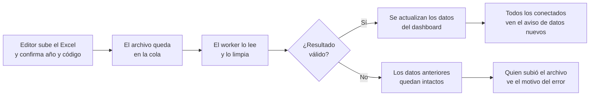
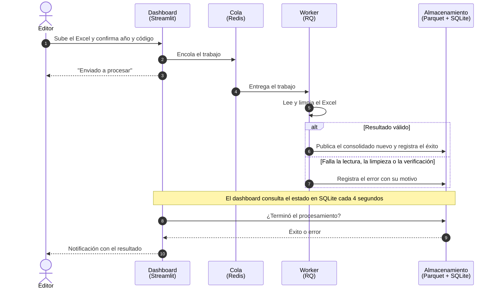

<p align="center">
  
</p>

<p align="center">
  Sistema de Vigilancia Departamental del Magdalena<br>
  CITES - Centro de Innovación y Transferencia en Salud, Universidad del Magdalena
</p>

# SIVIDEM

SIVIDEM es un dashboard web de vigilancia epidemiológica para el departamento del Magdalena (Colombia). Convierte los microdatos que publica el INS en el portal SIVIGILA en indicadores, mapas, canales endémicos y pronósticos de corto plazo, listos para apoyar decisiones de salud pública a nivel departamental, subregional y municipal.

La primera patología implementada es dengue. El sistema está construido como plataforma modular: cada patología es un plugin que cumple un contrato común, de modo que se pueden agregar nuevas (por ejemplo tuberculosis) sin modificar el núcleo.

La investigación que sustenta el sistema (análisis exploratorio, variables climáticas y comparación de modelos de pronóstico) está en el repositorio [dengue-surveillance-magdalena](https://github.com/Edmh1/dengue-surveillance-magdalena). Ver [Investigación y modelado](#investigación-y-modelado).

## Qué ofrece

- Situación actual: incidencia, mortalidad y letalidad del año (con alerta si la letalidad supera la meta nacional del INS), mapa del estado epidemiológico de cada subregión y canal endémico del territorio filtrado, con selector de método (cuartiles por defecto, o Bortman).
- Pronóstico: casos esperados en las próximas 1 a 6 semanas (se recomiendan hasta 4) con tres modelos sin clima, uno por familia: Prophet autorregresivo (estadístico, por defecto), XGBoost (aprendizaje automático) y LSTM (aprendizaje profundo), con opción de compararlos sobre la misma serie. Junto al pronóstico se muestra el error esperado por horizonte, medido en la validación walk-forward que el propio sistema corre al entrenar. Los modelos los reentrena el perfil de administración desde Gestión; cada reentrenamiento es una versión que se conserva. Incluye un modo de verificación con ejemplos históricos reales en el que el modelo solo ve datos hasta una fecha pasada y se compara con lo que ocurrió después. Ver [Pronóstico: modelos y desempeño](#pronóstico-modelos-y-desempeño).
- Tendencia: casos por año filtrables desde el mapa, comparación semanal contra el año anterior, variación porcentual, mapa interactivo de incidencia en tres niveles (subregión, municipio y el municipio partido en cabecera, centros poblados y rural disperso) y evolución por territorio.
- Sociodemográfica: pirámide por sexo y edad, grupos vulnerables, área, estrato, etnia, pueblos indígenas, régimen de salud, EPS y UPGD notificadoras.
- Morbilidad: gravedad, hospitalización, flujo de clasificación inicial a final (diagrama de Sankey), fuente de notificación y tasas por subregión y municipio.
- Mortalidad: muertes, letalidad y letalidad grave por subregión con referencia departamental, distribución por sexo, edad, semana, régimen y EPS, tabla por territorio y causas CIE-10.
- Gestión de datos desde la interfaz: subida de archivos SIVIGILA, reemplazo de archivos corregidos, papelera con restauración, historial de procesamientos y bitácora de auditoría.
- Multiusuario con roles (Visor, Editor, Admin) y autenticación centralizada en Keycloak.

La descripción completa de cada pestaña, con sus gráficas, selectores y reglas de cálculo, está en la [guía de módulos](docs/modulos.md).


## Arquitectura

SIVIDEM se despliega como cuatro contenedores orquestados con Docker Compose: la aplicación web (Streamlit), un worker de procesamiento (RQ), la cola (Redis) y el proveedor de identidad (Keycloak). Los datos de casos se guardan en Parquet y el estado operativo (procesamientos, bitácora, registro de archivos) en SQLite.

### Vista de contenedores


### Vista de despliegue


### Vista de componentes

El núcleo (core/) no conoce ninguna patología en particular; cada patología vive en pathologies/ e implementa el contrato PathologyPlugin.


### Flujo de una carga de datos



1. La persona sube el archivo desde la pestaña Gestión. El sistema propone año y código a partir del nombre y ella los confirma.
2. La interfaz no procesa el archivo: lo deja en una cola y la persona puede seguir trabajando. Si dos personas suben al mismo tiempo, los archivos se procesan en orden, uno a la vez.
3. Un proceso aparte (el worker) lee el Excel y lo limpia.
4. Antes de publicar, el sistema comprueba que el resultado esté completo. Si lo está, reemplaza los datos del dashboard de una sola vez, sin que nadie llegue a ver datos a medias, y todas las personas conectadas reciben un aviso para actualizar.
5. Si algo falla (archivo ilegible, falta una columna, resultado incompleto), los datos anteriores no se tocan y quien subió el archivo ve el motivo. El fallo queda registrado en el historial de Procesamientos.

#### Secuencia técnica

El mismo flujo, visto por componente:



- El dashboard y el worker no se hablan directamente: se comunican por la cola (para entregar el trabajo) y por SQLite (para saber cómo terminó).
- El consolidado nuevo se escribe aparte y se verifica antes de reemplazar al oficial con un cambio de nombre atómico. Por eso, si algo falla, el consolidado anterior sigue intacto.
- Las demás sesiones abiertas también revisan cada 4 segundos si cambió la fecha de modificación del consolidado. Cuando cambia, muestran el aviso de datos nuevos; los datos solo se recargan cuando cada persona pulsa Actualizar.

## Tecnologías

| Área | Herramienta |
|---|---|
| Interfaz y visualización | Streamlit, Plotly |
| Identidad y acceso | Keycloak (python-keycloak) |
| Procesamiento asíncrono | Redis, RQ |
| Datos de casos | Parquet (pandas, pyarrow) |
| Estado, bitácora y registro | SQLite |
| Lectura de Excel grandes (.xls y .xlsx) | calamine |
| Limpieza de datos | pandas, scikit-learn |
| Pronóstico | Prophet (cmdstanpy), XGBoost, TensorFlow/Keras (LSTM), epiweeks |
| Despliegue | Docker, Docker Compose |

## Estructura del repositorio

```
.
├── app.py                      # Entrada del dashboard: registra las patologías y arranca la interfaz
├── worker.py                   # Entrada del worker: atiende la cola, un archivo a la vez
├── docker-compose.yml
├── Dockerfile
├── requirements.txt
├── assets/                     # Logo e íconos institucionales
├── core/                       # Núcleo, independiente de cualquier patología
│   ├── auth/                   # Contrato AuthProvider, implementación Keycloak y permisos por rol
│   ├── audit/                  # SQLite: procesamientos, bitácora, registro de piezas y entrenamientos
│   ├── dashboard_base/         # Layout, login, filtros globales, avisos y pestaña de Gestión
│   ├── ingestion/              # Cola, procesador de piezas, papelera y reentrenamiento del pronóstico
│   ├── storage/                # Piezas, consolidado, escritura atómica y versiones de modelos
│   ├── references/             # GeoJSON de municipios y de zonas urbano-rurales
│   ├── geografia.py
│   └── registry.py             # Contrato PathologyPlugin y registro de patologías
├── pathologies/
│   └── dengue/                 # Plugin de dengue
│       ├── manifest.yaml       # Nombre, códigos esperados, rutas y columnas
│       ├── plugin.py           # Implementación del contrato
│       ├── clean.py            # Limpieza de los archivos SIVIGILA
│       ├── indicators.py       # Incidencia, mortalidad, letalidad
│       ├── canal_endemico.py   # Cuartiles y Bortman
│       ├── estratificacion.py  # Estratificación de riesgo MSPS/INS
│       ├── poblacion.py        # Población DANE y población en riesgo
│       ├── prediccion.py       # Prophet-AR, XGBoost y LSTM: entrenamiento, pronóstico recursivo y validación
│       ├── entrenamiento.py    # Reentrenamiento y exportación con manifest (lo corre el worker)
│       ├── schema.py           # Esquema estable de los datos procesados
│       ├── config/             # Subregiones y tablas de referencia
│       └── views/              # Las seis pestañas de análisis
├── docs/                       # Guía de módulos y diagramas
└── data/                       # Piezas, consolidado, papelera y sistema.db (generados en ejecución)
```

## Puesta en marcha

### Requisitos

- Docker y Docker Compose.
- Para desarrollo sin Docker: Python 3.12 y un servidor Redis. El worker de RQ requiere un sistema tipo Unix (Linux, macOS o WSL); en Windows, usar Docker para el worker.

### 1. Variables de entorno

```bash
cp .env.example .env
```

Completar .env. Dentro de Docker Compose el dashboard llega a Keycloak por el nombre del servicio:

```env
KEYCLOAK_SERVER_URL=http://keycloak:8080/
KEYCLOAK_REALM=cites
KEYCLOAK_CLIENT_ID=dashboard
KEYCLOAK_CLIENT_SECRET=<secreto del cliente en Keycloak>
```

### 2. Levantar los servicios

```bash
docker compose up --build
```

- Dashboard: http://localhost:8501
- Consola de Keycloak: http://localhost:8080 (credenciales iniciales admin / admin definidas en docker-compose.yml; cambiarlas fuera de un entorno local)

La primera construcción tarda varios minutos porque Prophet compila cmdstan durante la instalación y TensorFlow (para la LSTM del pronóstico) es una dependencia pesada.

Después de cargar los datos, un Admin tiene que entrenar el pronóstico por primera vez desde Gestión, apartado Pronóstico. Hasta entonces la pestaña Pronóstico explica que no hay modelo y solo funcionan sus modos históricos.

### 3. Configurar Keycloak

1. Crear el realm cites.
2. Crear el cliente dashboard con autenticación de cliente activada y el flujo Direct access grants habilitado (el login usa usuario y contraseña). Copiar su secreto en KEYCLOAK_CLIENT_SECRET y reiniciar el dashboard.
3. Crear los realm roles Visor, Editor y Admin.
4. Crear las cuentas y asignar a cada una uno de esos roles. Una cuenta sin ninguno de los tres roles no puede ingresar.

| Rol | Permisos |
|---|---|
| Visor | Ver todas las pestañas de análisis. |
| Editor | Todo lo del Visor, más subir, reemplazar y enviar a papelera archivos, restaurar desde la papelera y consultar procesamientos y bitácora. |
| Admin | Todo lo del Editor, más eliminar archivos para siempre desde la papelera y reentrenar el pronóstico. |

Los permisos de cada rol se definen en la aplicación (core/auth/permisos.py); Keycloak solo entrega la identidad y el rol.

### Desarrollo sin Docker

```bash
python -m venv .venv
source .venv/bin/activate
pip install -r requirements.txt

# con Redis y Keycloak disponibles y .env apuntando a ellos (por ejemplo KEYCLOAK_SERVER_URL=http://localhost:8080/)
python worker.py
streamlit run app.py
```

## Carga de datos

1. Descargar del portal de microdatos de SIVIGILA (INS) los archivos de dengue por año: código 210 (dengue), 220 (dengue grave) y 580 (mortalidad por dengue). El portal los nombra Datos_AÑO_CÓDIGO, por ejemplo Datos_2024_580.xls.
2. Ingresar con una cuenta Editor o Admin, abrir la pestaña Gestión y subir cada archivo. El sistema propone año y código a partir del nombre y pide confirmarlos.
3. La matriz de Piezas activas muestra qué combinaciones de año y código faltan.

Algunos análisis necesitan historia acumulada: el canal endémico pide al menos 5 años anteriores al año de vigilancia, la estratificación de riesgo (y con ella las tasas con población en riesgo) pide 6 años y el pronóstico necesita alrededor de 120 semanas continuas.

El procesamiento recorta automáticamente los casos al Magdalena por departamento de ocurrencia, valida los municipios contra DIVIPOLA y enriquece el dato con las tablas de referencia de pathologies/dengue/config/referencias (DIVIPOLA, países, ocupaciones, aseguradoras, CIE-10, grupos étnicos y proyecciones de población DANE).

Cuando se carga un año nuevo, el pronóstico sigue usando el modelo entrenado con los datos anteriores hasta que un Admin lo reentrene; la pestaña Pronóstico lo avisa.

### Capas geográficas

- core/references/municipios_magdalena.geojson: los 30 municipios, versión filtrada y simplificada del MGN.
- core/references/urbano_rural_magdalena.geojson: cada municipio partido en cabecera, centros poblados y rural disperso (340 polígonos), a partir de la capa original de 12,6 MB. Se corrigió la cabecera: en el original era todo el sector urbano del municipio, con el casco de los centros poblados incluido; ahora la cabecera es la pieza que no toca ningún centro poblado y cada casco se sumó a su centro poblado. Simplificada a 0,5 MB. Alimenta el tercer nivel del mapa de Tendencia, que dibuja dos zonas: cabecera y resto rural (centros poblados y rural disperso unidos), las únicas con tasa válida porque el DANE no separa la población de centro poblado y la de rural disperso. Los centros poblados no se dibujan por separado: no hay datos a ese nivel. Límites: el polígono de un centro poblado parte de la unión de las manzanas censales de 2018, no de un perímetro normativo; las clases vienen de 2018 y 2020 y se solapan un poco; dos centros poblados (47570008 y 47660015) no tienen nombre en la DIVIPOLA consultada.

Referencias:

Departamento Administrativo Nacional de Estadística. (2018). Marco Geoestadístico Nacional integrado al Censo Nacional de Población y Vivienda 2018: manzanas y secciones rurales [Conjunto de datos geográficos]. https://geoportal.dane.gov.co

Departamento Administrativo Nacional de Estadística. (2020). Marco Geoestadístico Nacional 2020: sector urbano y sector rural [Servicio de mapas ArcGIS]. https://portalgis.dane.gov.co/mparcgis/rest/services/MGN2020

Departamento Administrativo Nacional de Estadística. (s. f.). DIVIPOLA: códigos de municipios y centros poblados [Conjunto de datos]. Datos Abiertos Colombia. https://www.datos.gov.co/d/xaxy-8nri

## Agregar una nueva patología

1. Crear la carpeta pathologies/nombre_patologia/ con su manifest.yaml (nombre, códigos esperados, rutas y columnas).
2. Implementar una clase que herede de PathologyPlugin (core/registry.py): limpieza, indicadores, canal endémico, esquema, mapeo de subregiones y la lista de pestañas que expone. La estratificación de riesgo es opcional.
3. Registrar el plugin en app.py y en worker.py con registrar_patologia(...).
4. Opcional: si la patología tiene pronóstico, devolver desde obtener_pronostico() un objeto que implemente ModuloPronostico (core/registry.py). Con eso aparece el apartado de reentrenamiento en Gestión para el perfil de administración; sin él, la patología funciona igual.

El selector de patología, los filtros globales, la subida de archivos, la papelera, el historial, los avisos y la escritura atómica funcionan sin cambios para la nueva patología.

## Investigación y modelado

El análisis y la experimentación previos al sistema viven en un repositorio aparte: [dengue-surveillance-magdalena](https://github.com/Edmh1/dengue-surveillance-magdalena). Usa la serie histórica de SIVIGILA 2007-2024 del Magdalena y deja trazados los experimentos con MLflow. Este repositorio lleva a producción lo que allí se validó.

| Notebook | Qué contiene | Qué aportó a SIVIDEM |
|---|---|---|
| [01 Análisis exploratorio](https://github.com/Edmh1/dengue-surveillance-magdalena/blob/main/notebooks/01_dengue_eda.ipynb) | Limpieza y consolidación de los microdatos SIVIGILA | Las reglas de limpieza que aplica el worker (pathologies/dengue/clean.py) y la evidencia de subnotificación que llevó a calcular tasas por subregión |
| [02 Variables climáticas](https://github.com/Edmh1/dengue-surveillance-magdalena/blob/main/notebooks/02_dengue_climate_feature.ipynb) | Temperatura, precipitación y humedad de NASA POWER, ERA5 y CHIRPS, validadas contra estaciones del IDEAM | Las covariables climáticas que se evaluaron en el modelado |
| [03 Modelado](https://github.com/Edmh1/dengue-surveillance-magdalena/blob/main/notebooks/03_dengue_modeling.ipynb) | Comparación de SARIMAX, Prophet, XGBoost, LightGBM, LSTM y N-BEATS con evaluación walk-forward | Los rezagos de 1, 2, 4 y 8 semanas y la configuración de los modelos |
| [04 Agrupamiento](https://github.com/Edmh1/dengue-surveillance-magdalena/blob/main/notebooks/04_dengue_clustering.ipynb) | Agrupación de los municipios del Magdalena según su clima | Trabajo exploratorio, no integrado al sistema |
| [05 Ablación clima vs. rezagos](https://github.com/Edmh1/dengue-surveillance-magdalena/blob/main/notebooks/05_dengue_ablacion_clima_vs_lags.ipynb) | Aporte del clima frente al de los casos de semanas anteriores, por horizonte, y pronóstico multipaso sin clima | Pronóstico sin variables climáticas, la elección del mejor modelo de cada familia y el horizonte recomendado de 4 semanas |

### Pronóstico: modelos y desempeño

El tablero despliega el mejor modelo de cada familia a multipaso y sin covariables climáticas, según el notebook 05: Prophet-AR (estadístico; descartado SARIMAX), XGBoost (aprendizaje automático; descartado LightGBM) y LSTM (aprendizaje profundo; descartado N-BEATS, que se derrumba desde la tercera semana). Prophet queda por defecto por ser el único que se sostiene en todo el rango de horizontes y el mejor a 4 semanas.

Desempeño por horizonte (H, en semanas), sin clima, evaluación walk-forward del notebook 05 sobre la serie de investigación 2007-2024:

| Modelo | H | RMSE | MAE | MAPE | R² |
|---|---|---|---|---|---|
| Prophet | 1 | 12.335 | 8.909 | 23.07 % | 0.8672 |
| Prophet | 2 | 14.027 | 10.062 | 24.64 % | 0.8283 |
| Prophet | 3 | 16.292 | 11.638 | 28.45 % | 0.7684 |
| Prophet | 4 | 17.468 | 12.415 | 30.75 % | 0.7337 |
| Prophet | 6 | 20.761 | 14.152 | 35.37 % | 0.6239 |
| XGBoost | 1 | 12.912 | 9.528 | 24.65 % | 0.8545 |
| XGBoost | 2 | 13.937 | 10.112 | 26.48 % | 0.8305 |
| XGBoost | 3 | 15.884 | 11.807 | 30.42 % | 0.7798 |
| XGBoost | 4 | 17.804 | 13.361 | 35.29 % | 0.7234 |
| XGBoost | 6 | 23.585 | 16.665 | 40.74 % | 0.5146 |
| LSTM | 1 | 12.968 | 9.025 | 22.40 % | 0.8533 |
| LSTM | 2 | 14.661 | 10.229 | 24.37 % | 0.8124 |
| LSTM | 3 | 17.387 | 11.787 | 27.40 % | 0.7362 |
| LSTM | 4 | 19.815 | 13.479 | 31.10 % | 0.6574 |
| LSTM | 6 | 24.317 | 16.267 | 35.89 % | 0.4840 |
| Persistencia (línea base) | 1 | 13.211 | 9.950 | 26.11 % | 0.8477 |
| Persistencia (línea base) | 2 | 14.007 | 10.440 | 25.90 % | 0.8288 |
| Persistencia (línea base) | 3 | 17.543 | 12.702 | 30.76 % | 0.7315 |
| Persistencia (línea base) | 4 | 19.942 | 14.929 | 36.52 % | 0.6530 |
| Persistencia (línea base) | 6 | 24.926 | 17.702 | 44.25 % | 0.4579 |

XGBoost es el mejor en la segunda y la tercera semana; Prophet en la primera, la cuarta y la sexta. La LSTM apenas supera a la persistencia a partir de la cuarta semana.

Esta tabla justifica la elección de las familias y está también en el diálogo de Fundamentación de la pestaña Pronóstico. El error que acompaña al pronóstico en la pestaña es otro: el que calcula el propio sistema cada vez que se reentrena (validación walk-forward sobre el último 15 % de los datos cargados, horizontes de 1 a 6 semanas), guardado en el manifest de cada versión de modelos.

Reentrenamiento: el modelo no se entrena solo. Un Admin lo lanza desde Gestión, apartado Pronóstico; el worker valida y entrena los tres modelos con todo el histórico, los exporta en una carpeta versionada (data/dengue/modelos/<versión>, con un manifest.json que dice fecha, usuario, rango de datos, hiperparámetros, error por horizonte y versión del código) y la deja activa. Las versiones anteriores se conservan y se puede volver a cualquiera; queda registrado quién lo hizo, cuándo, con qué datos y cuánto tardó.

## Metodología y referencias

- Protocolo de vigilancia en salud pública de dengue, Instituto Nacional de Salud (INS).
- Bortman M. Elaboración de corredores o canales endémicos mediante planillas de cálculo. Rev Panam Salud Pública. 1999;5(1).
- Lineamiento metodológico para la estratificación y estimación de la población en riesgo para arbovirosis en Colombia 2020-2023, Ministerio de Salud y Protección Social e INS.
- Proyecciones de población municipal DANE, Censo Nacional de Población y Vivienda 2018.
- Taylor SJ, Letham B. Forecasting at scale. The American Statistician. 2018;72(1).

## Créditos

Desarrollado para el CITES (Centro de Innovación y Transferencia en Salud) de la Universidad del Magdalena, Santa Marta, Colombia.
